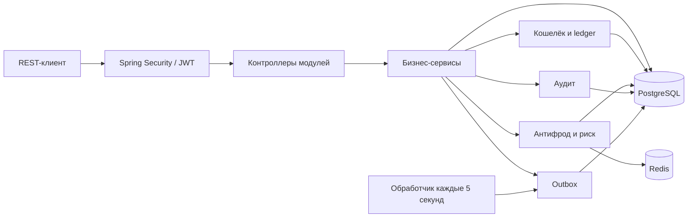

<div align="center">

# 🏟️ SportsBook

**Backend спортивных ставок с финансовым журналом, JWT / TOTP и антифрод-модулями**


[Возможности](#-возможности) · [Архитектура](#-архитектура) · [Запуск](#-локальный-запуск) · [API](#-api) · [Документация](#-документация)

</div>

---

SportsBook — учебный и портфолио-проект на Java: модульный монолит, в котором размещение ставки связано с резервированием денег, расчётом результата, аудитом и проверками ограничений игрока. Отдельные модули моделируют выявление связанных аккаунтов и оценку риска.

> [!NOTE]
> Проект находится в разработке. Найденные критические ошибки запуска, MFA и вывода средств исправлены. История анализа, исправления и оставшиеся ограничения — в [отчёте](docs/PROJECT_ANALYSIS.md).

## ✨ Возможности

| Область | Реализовано в коде |
| :--- | :--- |
| **Аккаунты** | Регистрация с проверкой возраста 18+, BCrypt, роли и статусы пользователя |
| **Аутентификация** | Stateless JWT, TOTP MFA, двухэтапный вход |
| **Кошелёк** | Доступный, зарезервированный и бонусный балансы; журнал `WalletEntry`; optimistic locking |
| **Линия** | Спортивные события, рынки и исходы с коэффициентами; административные API создания |
| **Ставки** | Одиночные ставки, проверка открытого рынка и ожидаемого коэффициента, резервирование средств |
| **Расчёт** | Результаты `WON`, `LOST`, `VOID`, `CANCELLED`, выплаты и возвраты |
| **Ответственная игра** | Лимиты депозитов и ставок, самоисключение |
| **Бонусы** | Кампании, выдача бонусов, хранение требования отыгрыша и проверка связанных аккаунтов |
| **Платежи** | Fingerprint платёжных инструментов; вывод с KYC, risk decision и резервированием; удержание для проверки |
| **Антифрод** | Правила, сигналы, связи аккаунтов, взвешенный risk score, fraud cases и Redis velocity counters |
| **События и мониторинг** | Outbox для `BET_PLACED`, фоновая обработка, Actuator, Micrometer, trace ID |

Наличие модуля не означает завершённую интеграцию во все бизнес-сценарии: например, правило частоты регистраций пока не вызывается из регистрации.

## 🧩 Архитектура

**Модульный монолит · package-by-feature · REST API**



Модули организованы вокруг предметных областей. Внутри используются пакеты `api`, `service`, `model` и `repository` по необходимости.

```text
src/main/java/com/example/sportsbook/
├── auth                # Регистрация, вход, TOTP
├── security            # JWT, фильтры, роли и principal
├── user                # Пользователи, статусы, KYC
├── wallet              # Балансы и журнал операций
├── sports              # Спортивные события и управление линией
├── market              # Рынки, исходы, коэффициенты
├── betting             # Размещение одиночных ставок
├── settlement          # Расчёт результатов
├── responsiblegaming   # Лимиты и самоисключение
├── bonus               # Бонусные кампании
├── payment             # Инструменты и заявки на вывод
├── fraud               # Правила, сигналы, связи, риск, cases
├── audit               # Журнал действий
└── common              # Ошибки, health, Outbox
```

### Деньги и транзакции

- Денежные значения обрабатываются через `BigDecimal`; операции кошелька округляются до двух знаков.
- Ставка переносит деньги из доступного баланса в резерв внутри транзакции.
- `@Version` на кошельке позволяет обнаруживать конкурентные изменения.
- Операции кошелька используют ключи идемпотентности и создают записи `WalletEntry`.
- Расчёт ставки обновляет её статус и баланс; повторный расчёт ограничивается проверками сервиса.

### Защита

Архитектурная модель включает четыре уровня: Spring Security → проверка владельца ресурса → бизнес-валидация → решение антифрода. Их фактическое применение зависит от конкретного сценария.

Роли: `PLAYER`, `SUPPORT`, `RISK_ANALYST`, `TRADER`, `ADMIN`. Access JWT действует **15 минут**, промежуточный MFA-токен — **5 минут**. MFA-токен принимается только при завершении второго этапа входа и не создаёт authenticated principal. Завершение MFA повторно проверяет текущий статус аккаунта.

## 🚀 Локальный запуск

### Требования

- JDK **21**.
- Maven **3.6.3+**, установленный отдельно: Maven Wrapper в репозитории отсутствует.
- PostgreSQL и Redis. Команды ниже используют PostgreSQL 16 и Redis 7 как пример локального окружения.
- Docker для запуска этих сервисов в контейнерах либо уже установленные сервисы.

### 1. Получить проект

```bash
git clone https://github.com/ursusandwolf/sportsbook.git
cd sportsbook
```

### 2. Поднять PostgreSQL и Redis

```bash
docker run --name sportsbook-postgres -e POSTGRES_DB=sportsbook -e POSTGRES_USER=postgres -e POSTGRES_PASSWORD=password -p 127.0.0.1:5432:5432 -d postgres:16-alpine
docker run --name sportsbook-redis -p 127.0.0.1:6379:6379 -d redis:7-alpine
```

Дождитесь готовности PostgreSQL: `docker exec sportsbook-postgres pg_isready -U postgres -d sportsbook`. Эти параметры совпадают с [application.yml](src/main/resources/application.yml). Для повторного старта созданных контейнеров используйте `docker start sportsbook-postgres sportsbook-redis`.

### 3. Задать JWT_SECRET

Ключ должен быть **Base64-строкой**, декодирующейся как минимум в **32 случайных байта**. Задайте переменную в том же терминале, где запускаете приложение.

<details>
<summary><strong>PowerShell</strong></summary>

```powershell
$jwtBytes = New-Object byte[] 32
$jwtRng = [System.Security.Cryptography.RandomNumberGenerator]::Create()
$jwtRng.GetBytes($jwtBytes)
$jwtRng.Dispose()
$env:JWT_SECRET = [Convert]::ToBase64String($jwtBytes)
```

</details>

<details>
<summary><strong>Bash / Linux / macOS (OpenSSL)</strong></summary>

```bash
export JWT_SECRET="$(openssl rand -base64 32)"
```

</details>

### 4. Запустить приложение

```bash
mvn spring-boot:run
```

Liquibase применяет подключённые миграции при старте, после чего Hibernate проверяет схему. По умолчанию сервер слушает `http://localhost:8080`.

```bash
curl http://localhost:8080/api/public/health
```

Ожидаемый ответ после успешного запуска:

```json
{"status":"UP"}
```

Этот endpoint проверяет доступность HTTP-приложения. Состояние зависимостей доступно через `/actuator/health`.

### Настройка окружения

| Переменная | Значение по умолчанию / назначение |
| :--- | :--- |
| `JWT_SECRET` | Обязательный Base64-ключ подписи JWT |
| `SPRING_DATASOURCE_URL` | `jdbc:postgresql://localhost:5432/sportsbook` |
| `SPRING_DATASOURCE_USERNAME` | `postgres` |
| `SPRING_DATASOURCE_PASSWORD` | `password` |
| `SPRING_DATA_REDIS_HOST` | `localhost` |
| `SPRING_DATA_REDIS_PORT` | `6379` |
| `APP_CORS_ALLOWED_ORIGINS` | `http://localhost:3000` |
| `SERVER_PORT` | `8080` |

Spring Boot читает переменные окружения. Файл `.env` автоматически не загружается. Миграции содержат демонстрационные аккаунты; конфигурация предназначена для локального изучения проекта.

## 🔌 API

Основные маршруты из контроллеров:

| Метод | Маршрут | Назначение |
| :--- | :--- | :--- |
| `GET` | `/api/public/health` | Проверка HTTP-приложения |
| `POST` | `/api/auth/register` | Регистрация игрока |
| `POST` | `/api/auth/login` | Вход по email и паролю |
| `POST` | `/api/auth/verify-2fa` | Завершение MFA-входа |
| `POST` | `/api/auth/mfa/setup`, `/api/auth/mfa/enable` | Настройка TOTP с access JWT |
| `GET` | `/api/users/me` | Профиль текущего пользователя |
| `GET` | `/api/sports/events` | Публичный список событий |
| `GET` | `/api/wallets/me` | Баланс текущего пользователя |
| `POST` | `/api/wallets/deposit` | Пополнение кошелька |
| `POST` | `/api/bets` | Размещение ставки игроком |
| `POST` | `/api/withdrawals` | Заявка на вывод с KYC-проверкой |
| `POST` | `/api/v1/responsible-gaming/limits`, `/api/v1/responsible-gaming/self-exclude` | Лимиты и самоисключение |
| `GET` | `/api/v1/bonuses/me/balance` | Бонусный баланс |
| `POST` | `/api/admin/sports/events`, `/api/admin/sports/markets`, `/api/admin/sports/selections` | Создание линии: trader / admin |
| `POST` | `/api/admin/bets/{betId}/settle` | Расчёт ставки: trader / admin |
| `GET`, `DELETE` | `/api/admin/users`, `/api/admin/users/{id}` | Управление пользователями: admin |
| `POST` | `/api/admin/bonuses/campaigns`, `/api/admin/bonuses/issue` | Управление бонусами: admin |
| `PATCH` | `/api/admin/fraud/cases/{id}/status` | Статус fraud case: risk analyst |

Для защищённых запросов передавайте `Authorization: Bearer <access-token>`. Swagger UI / OpenAPI пока не подключены.

Прежний `POST /api/wallets/withdraw` закрыт и возвращает `403` аутентифицированным пользователям. Используйте `POST /api/withdrawals?amount=40.00&destinationFingerprint=...`: он резервирует деньги и возвращает DTO с `id`, `amount`, `status`, `createdAt`. Статус `HELD_FOR_REVIEW` требует дальнейшей проверки; исполнение внешнего платежа пока не реализовано.

<details>
<summary><strong>Пример регистрации, входа и пополнения (Bash)</strong></summary>

После запуска приложения:

```bash
curl -X POST http://localhost:8080/api/auth/register \
  -H 'Content-Type: application/json' \
  -d '{"email":"demo@example.com","password":"DemoPass123!","confirmPassword":"DemoPass123!","dateOfBirth":"1995-01-01"}'

curl -X POST http://localhost:8080/api/auth/login \
  -H 'Content-Type: application/json' \
  -d '{"email":"demo@example.com","password":"DemoPass123!"}'
```

При выключенной MFA ответ содержит `token`. Скопируйте его в переменную:

```bash
TOKEN='<значение token из ответа>'

curl http://localhost:8080/api/wallets/me \
  -H "Authorization: Bearer $TOKEN"

curl -X POST http://localhost:8080/api/wallets/deposit \
  -H "Authorization: Bearer $TOKEN" \
  -H 'Content-Type: application/json' \
  -d '{"amount":100.00,"idempotencyKey":"demo-deposit-001"}'
```

При включённой MFA вход возвращает `202 Accepted` с `mfaToken`; затем `/api/auth/verify-2fa` принимает `mfaToken` и `code`. Схема — в [MFA_FLOW.md](docs/MFA_FLOW.md).

</details>

## 🧪 Сборка и тесты

```bash
mvn test
mvn package
java -jar target/sportsbook-0.0.1-SNAPSHOT.jar
```

Для запуска JAR нужны те же PostgreSQL, Redis и `JWT_SECRET`.

В репозитории есть тесты security, MFA, кошелька, линии, ставок, расчёта, ответственной игры, бонусов, платежей и антифрода. Spring-интеграционные тесты используют профиль `test` с **H2 в PostgreSQL mode**; Redis velocity тестируется с Mockito. Зависимости Testcontainers объявлены, но контейнерные тесты пока не реализованы.

Проверка 10 октября 2026 года: **`mvn clean verify` — 56 тестов, 0 ошибок, 0 failures, 0 пропусков; BUILD SUCCESS**. Основной тестовый профиль выполняет production-миграции, адаптирует TEXT только для H2 и проверяет схему Hibernate; `SecurityIntegrationTests` отдельно использует `create-drop` без Liquibase. Подробности — в [отчёте](docs/PROJECT_ANALYSIS.md#проверки).

## 📊 Наблюдаемость

- `/actuator/health`, `/actuator/info`, `/actuator/metrics`.
- Метрики Outbox: `outbox.events.processed`, `outbox.events.processing.time`.
- Фильтр `TraceIdFilter` связывает запросы через MDC.
- Обработчик Outbox каждые 5 секунд берёт до 100 событий, логирует их и помечает обработанными. Публикация в брокер пока не реализована.

В конфигурации указан `prometheus`, но зависимость `micrometer-registry-prometheus` отсутствует. Health доступен публично без деталей зависимостей; остальные Actuator endpoints требуют роль `ADMIN`.

## 📚 Документация

| Документ | Содержание |
| :--- | :--- |
| [Анализ проекта](docs/PROJECT_ANALYSIS.md) | Фактическое состояние, блокеры запуска и расхождения документации |
| [Контекст проекта](docs/PROJECT_CONTEXT.md) | Заявленный статус итераций и roadmap |
| [Техническая документация](docs/DOCUMENTATION.md) | Архитектура, кошелёк, ставки, расчёт и аудит |
| [MFA Flow](docs/MFA_FLOW.md) | Диаграммы настройки TOTP и двухэтапного входа |
| [UML](docs/UML.md) | Структура и взаимодействие ключевых классов |
| [Changelog](docs/CHANGELOG.md) | История итераций |
| [Исходная спецификация](sportsbook-spring-security-antifraud-agent-prompt.md) | Требования, ограничения и план развития |

Ближайшие задачи: подключить регистрационные антифрод-проверки, реализовать исполнение и завершение вывода средств, добавить реальные PostgreSQL/Redis тесты, OpenAPI и публикацию событий в брокер.
